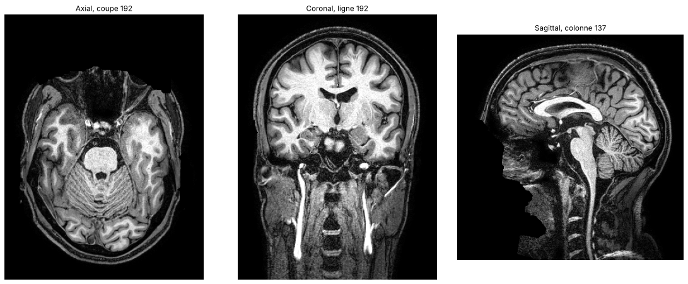

# Lire une IRM au format DICOM avec Python

Un notebook qui ouvre une IRM de la tête, empile ses 384 coupes en un volume 3D, l'affiche dans les trois plans et mesure un volume en litres.



## Ce qu'il montre

1. Lire un fichier DICOM et son en-tête avec `pydicom`
2. Trier les coupes d'après leur position dans l'espace, puis les empiler avec `numpy`
3. Afficher une grille de coupes
4. Afficher les plans axial, coronal et sagittal sans déformation
5. Régler le contraste à partir de l'histogramme
6. Séparer les tissus du fond par un seuil et convertir un nombre de voxels en litres

## Lancer

Il faut Python 3.10 ou plus récent.

```
python -m venv .venv
.venv\Scripts\activate
pip install -r requirements.txt
```

Sous Linux ou macOS, la deuxième ligne devient `source .venv/bin/activate`.

Ouvre ensuite `irm_dicom.ipynb` dans VS Code, choisis l'environnement `.venv` comme noyau et lance toutes les cellules. La première exécution télécharge les images (quelques dizaines de Mo) dans le dossier `donnees/`.

## Les images

Elles viennent du dépôt [example-dicom-structural](https://github.com/datalad/example-dicom-structural), un extrait du projet studyforrest.

Hanke M. et al., A high-resolution 7-Tesla fMRI dataset from complex natural stimulation with an audio movie, Scientific Data, 2014, 1, 140003.

Elles sont dans le domaine public (licence PDDL). Le visage a été effacé et les champs d'identité de l'en-tête remplacés par des valeurs fictives. Elles ne sont pas copiées dans ce dépôt, le notebook les télécharge.

## Limite

Le volume calculé à la fin est celui de tout ce qui donne du signal (cerveau, muscles, peau, graisse), pas celui du cerveau. Il dépend du seuil choisi.
